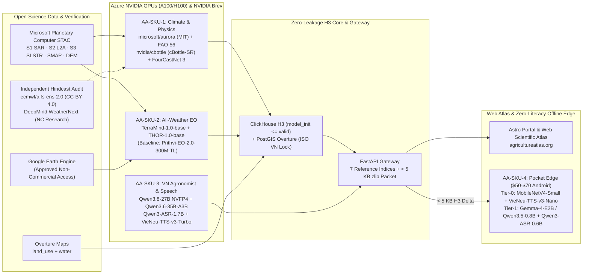

# Agriculture Atlas

**Zero-IoT Virtual Agro-Sensor Twins & Offline Zero-Literacy Agronomic Reference Systems for Climate-Vulnerable Smallholder Farming**

[](https://agricultureatlas.org)
[](https://doi.org/10.5281/zenodo.24465445)
[](https://orcid.org/0009-0005-3514-106X)
[](LICENSE)
[](DATA_LICENSE.md)
[](https://sdgs.un.org/goals)
[](#4-sku-open-science-golden-stack)
[](#architecture-overview)

> **Tóm tắt tiếng Việt:** **Agriculture Atlas** ([`https://agricultureatlas.org`](https://agricultureatlas.org)) là sáng kiến **Khoa học Mở, Phi Thương Mại & Phi Lợi Nhuận 100%** (UN SDG #2 & #13), biến từng ô lưới lục giác `Uber H3` tại Việt Nam (gồm 5 vùng trọng điểm và khẳng định 100% chủ quyền **Quần đảo Hoàng Sa** & **Quần đảo Trường Sa**, mã ISO `VN`) thành **Trạm Cảm Biến Nông Nghiệp Ảo Không Cần Phần Cứng IoT**. Hệ thống kết hợp vật lý nông học chuẩn **FAO-56 Penman-Monteith**, kiến trúc **4-SKU Golden Stack** (100% lõi `MIT / Apache-2.0` trên **Microsoft Azure NVIDIA GPUs & NVIDIA Brev**), gói tin đồng bộ Offline `< 5 KB` và ứng dụng di động **Không Chữ (`Zero-Literacy`)** cho nông dân. Mọi đầu ra là **chỉ số nông học tham khảo**, không phải bản tin dự báo hay cảnh báo khí tượng thủy văn/thiên tai chính thức (tuân thủ Luật KTTV 2015 / Nghị định 38/2016).

---

## Abstract

Smallholder farmers face severe agronomic climate risks while remaining priced out of \$500–\$2,000 field IoT sensors and underserved by text-heavy, cloud-dependent tools. **Agriculture Atlas** is a 100% non-commercial, air-gapped open-science initiative that models **Uber H3** hexagonal cells (`h3_res7` / `h3_res8`) joined with **Overture Maps** agricultural `land_use` and `water` geometries as **Zero-IoT Virtual Agro-Sensor Twins**.

The platform couples deterministic **FAO-56 Penman-Monteith** agro-physics (computing seven bounded reference agronomic indices) with a permissive **100% MIT / Apache-2.0 four-SKU foundation model stack** engineered for **Microsoft Azure NVIDIA GPUs** (`Standard_NC24ads_A100_v4`, `Standard_ND96isr_H100_v5`) and **NVIDIA Brev**, paired with `< 5 KB` `zlib`-compressed offline delta packets and a Zero-Literacy Sensory mobile experience for \$50–\$70 Android handsets (2–4 GB RAM).

- **Full Technical Report (v1.0.0, OSF Preregistration Ready):** [`docs/technical-report/AGRICULTURE_ATLAS_TECHNICAL_REPORT_V1.md`](docs/technical-report/AGRICULTURE_ATLAS_TECHNICAL_REPORT_V1.md)
- **Live Portal & Research Hub:** [`https://agricultureatlas.org`](https://agricultureatlas.org) · [`/research`](https://agricultureatlas.org/research) · [`/vi/research`](https://agricultureatlas.org/vi/research) · [`/en/chat`](https://agricultureatlas.org/en/chat) · [`/vi/chat`](https://agricultureatlas.org/vi/chat)
- **API Gateway:** [`https://api.agricultureatlas.org`](https://api.agricultureatlas.org)

---

## Architecture Overview



---

## 4-SKU Open-Science "Golden Stack"

All production-core models are strictly **MIT** or **Apache-2.0**. Experimental non-Apache baselines are isolated and explicitly flagged.

| SKU | Codename | Core Models (Verified Hugging Face IDs) | License | Compute / Deployment Target |
| :--- | :--- | :--- | :--- | :--- |
| **`AA-SKU-1`** | `AgricultureAtlas-Climate-Aurora-Earth2` | `microsoft/aurora` (`v1.5`, `v1.5-ensemble`, `0.1-finetuned`, `wave`, `air-pollution`, `small`) + deterministic **FAO-56 Penman-Monteith** + `nvidia/cbottle` (`cBottle-SR`, 330M) + `nvidia/fourcastnet3` (710.9M) | **MIT / Apache-2.0** | Microsoft Azure NVIDIA A100/H100 & Brev (PyTorch + CUDA) |
| **`AA-SKU-2`** | `AgricultureAtlas-EO-TerraMind-THOR` | `ibm-esa-geospatial/TerraMind-1.0-base` (9-modal S1 SAR/S2/DEM/LULC/NDVI + `Flood`/`Fire`) + `FM4CS/THOR-1.0-base` (Sentinel-3 SLSTR thermal LST); optical baseline `ibm-nasa-geospatial/Prithvi-EO-2.0-300M-TL` | **Apache-2.0** | Microsoft Azure NVIDIA A100/H100 & Brev (TerraTorch + PyTorch) |
| **`AA-SKU-3`** | `AgricultureAtlas-Agronomist-Qwen38-VN` | `Qwen/Qwen3.8-27B` + `nvidia/Qwen3.8-27B-NVFP4` (27.78B, ModelOpt NVFP4) + `Qwen/Qwen3.6-35B-A3B` (3B active MoE) + `Qwen/Qwen3-ASR-1.7B` (vs. `nemotron-3.5-asr-streaming-0.6b` & `PhoWhisper-large`) + `pnnbao-ump/VieNeu-TTS-v3-Turbo` (130.9M, 48 kHz, 23 VN voices; ASEAN backup `VoxCPM2`, `ZONOS3-Mini`) | **Apache-2.0** *(Core)* | Microsoft Azure NVIDIA H100/A100 & Brev (vLLM / TensorRT-LLM / ModelOpt NVFP4) |
| **`AA-SKU-4`** | `AgricultureAtlas-Edge-Pocket` | **Tier-0 (2–4 GB RAM):** `timm/mobilenetv4_conv_small.e2400_r224_in1k` (3.8M) + `pnnbao-ump/VieNeu-TTS-v3-Nano` (48M ONNX)<br>**Tier-1 (Apache-2.0 Default):** `google/gemma-4-E2B-it` (`litert-community/gemma-4-E2B-it-litert-lm`) & `Qwen/Qwen3.5-0.8B` (`Q4_0`, 563 MB) + `Qwen/Qwen3-ASR-0.6B-hf`<br>*Experimental comparison baseline only (non-core):* `LiquidAI/LFM3-Omni-2B-GGUF` (`LFM Open License v1.0`) | **Apache-2.0** *(Tier-0 & Tier-1 core)* | \$50–\$70 Android handsets (2–4 GB RAM, 100% Offline + `< 5 KB` H3 delta packet) |

---

## Implementation vs. Grant-Gated Research Status (100% Honest Audit)

Agriculture Atlas strictly distinguishes implemented deterministic artifacts from preregistered GPU workloads. **No neural accuracy, WER, MOS, or live hindcast metrics are fabricated.**

| Component | Status | Verification Scope |
| :--- | :--- | :--- |
| **FAO-56 Penman-Monteith & 7 Reference Indicators** | **Implemented (Tier-1)** | Deterministic physics & physical bounds runnable via `pytest` |
| **5 Vietnam Zones + ISO `VN` Sovereignty Lock (incl. Hoàng Sa & Trường Sa)** | **Implemented (Tier-1)** | Locked in PostGIS DDL, Physics Engine, and API endpoints |
| **ClickHouse H3 Zero-Leakage DDL (`model_init_time_utc <= valid_time_utc`)** | **Implemented (Tier-1)** | Schema & causal join view in `migrations/001_*.sql` |
| **`< 5 KB` (`< 5,120 B`) `zlib` Offline H3 Delta Packet** | **Implemented (Tier-1)** | Lossless round-trip encoder/decoder & API endpoint |
| **FastAPI Gateway, Astro Portal, Web Atlas & Zero-Literacy Mobile Prototype** | **Implemented (Tier-1)** | 4 mandatory UI states (`Loading`, `Empty`, `Error`, `Populated`) + regulatory copy checks |
| **Live Planetary Computer STAC / GEE Non-Commercial Ingestion** | **Grant-Gated (Tier-2)** | Pending cloud storage & Azure NVIDIA GPU grant provisioning |
| **`AA-SKU-1` Aurora / cBottle-SR / FourCastNet 3 Hindcasts vs. AIFS-ENS 2.0 & WeatherNext** | **Preregistered / Unmeasured (Tier-2)** | Pending Azure NVIDIA A100/H100 compute grant |
| **`AA-SKU-2` TerraMind-1.0 & THOR-1.0 SAR/Thermal Fine-Tuning** | **Preregistered / Unmeasured (Tier-2)** | Pending Azure NVIDIA A100/H100 compute grant |
| **`AA-SKU-3` Qwen3.8-27B NVFP4 / Qwen3-ASR / VieNeu-TTS Benchmarks** | **Preregistered / Unmeasured (Tier-2)** | Pending Azure NVIDIA H100 / Brev compute grant |
| **`AA-SKU-4` Edge Leaf Pathology Training & \$50–\$70 Android Profiling** | **Preregistered / Unmeasured (Tier-2)** | Open VN datasets preregistered (`minhhungg/rice-disease-dataset`, `durian-disease-vinh-long`, `Project-AgML/*`); metrics unmeasured |

---

## Reproducible Quickstart

### 1. Run Deterministic Physics, API & UI Verification Suites (Offline CPU)
```bash
git clone https://github.com/vantbhp/agricultureatlas.git
cd agricultureatlas
python3 -m pip install fastapi httpx pytest
pytest -v
```

### 2. Launch the Local FastAPI Reference Gateway (`http://127.0.0.1:8090`)
```bash
PYTHONPATH=services/agriatlas-gateway python3 -m app.main
```
Inspect key endpoints:
- `GET http://127.0.0.1:8090/healthz`
- `GET http://127.0.0.1:8090/api/v1/agro/vietnam-zones`
- `GET http://127.0.0.1:8090/api/v1/agro/sku-manifest`
- `GET http://127.0.0.1:8090/api/v1/agro/h3/8765b566affffff?agro_zone_code=VN_MKD`
- `GET http://127.0.0.1:8090/api/v1/agro/delta-packet/8765f1a2affffff?agro_zone_code=VN_HS_TS`

### 3. Build the Static Open-Science Portal (`apps/agriatlas-landing`)
```bash
cd apps/agriatlas-landing
npm ci
npm run build
```

---

## Repository Map

```text
agricultureatlas/
├── LICENSE                                                    # Apache-2.0 license for all first-party software
├── DATA_LICENSE.md                                            # CC-BY-4.0 report/data license & third-party model/dataset provenance
├── CITATION.cff                                               # CFF 1.2.0 scholarly citation metadata (ORCID linked)
├── .zenodo.json                                               # Zenodo archive metadata for DOI minting
├── README.md                                                  # Academic Open-Science overview & reproducible quickstart
├── PRD.md                                                     # Phase 1 Vietnam Product Requirements, 4-SKU Golden Stack & 4 UI states
├── docs/
│   └── technical-report/
│       ├── AGRICULTURE_ATLAS_TECHNICAL_REPORT_V1.md           # Publication-grade Technical Report v1.0 (Zenodo PDF/A & OSF ready)
│       └── references.bib                                     # Machine-readable BibTeX bibliography
├── configs/
│   ├── DESIGN_ART_DIRECTION_LOCK.json                         # Compact scientific typography lock (<= 22px) & 3-color traffic light
│   ├── LOGIC_FRICTION_DOSSIER.json                            # Independent agronomic UX friction audit
│   └── contract_lock.json                                     # SHA-256 architecture contract & air-gap lock
├── migrations/
│   ├── 001_clickhouse_h3_agro_virtual_sensor_vn.sql           # ClickHouse H3 ReplacingMergeTree (DoubleDelta + ZSTD, zero future leakage)
│   └── 002_postgis_overture_agro_landuse_vn.sql               # PostGIS + Overture Maps land_use/water & ISO VN sovereignty lock
├── services/
│   └── agriatlas-gateway/
│       └── app/
│           ├── main.py                                        # FastAPI Gateway (api.agricultureatlas.org)
│           └── core/agro_physics_engine.py                    # FAO-56 Penman-Monteith, 7 reference indices & < 5 KB zlib delta codec
├── apps/
│   ├── agriatlas-landing/                                     # Static Astro Open-Science Portal (https://agricultureatlas.org)
│   ├── agriatlas-web/                                         # Web Scientific H3 Atlas (/en/chat, /vi/chat) with 4 mandatory UI states
│   └── agriatlas-mobile-zero-literacy/                        # Flutter 60fps Zero-Literacy Sensory App & interactive HTML voice simulator
└── tests/
    ├── test_agro_physics_and_api.py                           # Agro-physics, < 5 KB packet, API, sovereignty & air-gap discipline tests
    ├── test_landing_static_build.py                           # Static build, i18n, regulatory phrasing & PI attribution tests
    └── test_ui_typography_and_states.py                       # <= 22px typography ceiling, 4 UI states & Zero-Literacy UX tests
```

---

## FAIR Governance, Legal Posture & Epistemic Boundary

- **Non-Commercial Air-Gap:** Built exclusively as a public-good open-science initiative; zero shared weights, codebases, databases, or cloud credits with commercial products.
- **Vietnam Hydrometeorology Law Compliance:** Pursuant to Vietnam **Law No. 90/2015/QH13** and **Decree No. 38/2016/ND-CP**, Agriculture Atlas computes **reference agronomic indices** (*chỉ số nông học tham khảo*) and does **not** issue official hydrometeorological forecasts or statutory disaster warnings. Multi-week forward projections remain gated on formal Vietnamese legal counsel confirmation.
- **Geospatial Sovereignty:** All Phase 1 Vietnam schemas strictly lock `country_code = 'VN'` across mainland Vietnam and Vietnam's islands, including **Hoàng Sa (Đà Nẵng)** and **Trường Sa (Khánh Hòa)** archipelagos.

---

## Citation

If you use Agriculture Atlas software, schemas, or the v1.0 Technical Report in academic research or grant applications, please cite:

```bibtex
@techreport{le2026agricultureatlas,
  author      = {Le, Van},
  title       = {Agriculture Atlas: Zero-IoT Virtual Agro-Sensor Twins and Offline Zero-Literacy Agronomic Reference Systems for Climate-Vulnerable Smallholder Farming},
  institution = {Agriculture Atlas Open-Science Initiative},
  year        = {2026},
  month       = {11},
  number      = {AA-TR-2026-01 (Version 1.0.0)},
  doi         = {10.5281/zenodo.24465446},
  url         = {https://doi.org/10.5281/zenodo.24465446},
  note        = {Principal Investigator: Van Le (Lê Thành Văn), ORCID: 0009-0005-3514-106X. Code: https://github.com/vantbhp/agricultureatlas. Concept DOI (all versions): https://doi.org/10.5281/zenodo.24465445}
}
```

---

## Principal Investigator & Grant Contact

- **Principal Investigator & Lead AI Systems Architect:** **Van Le (Lê Thành Văn)**
- **ORCID iD:** [`https://orcid.org/0009-0005-3514-106X`](https://orcid.org/0009-0005-3514-106X)
- **PI Direct Email:** `van.le@agricultureatlas.org`
- **Open-Science & Dataset Inquiries:** `research@agricultureatlas.org`
- **Compute Grants & Philanthropic Partnerships:** `grants@agricultureatlas.org`
- **General Inquiries:** `hello@agricultureatlas.org`
