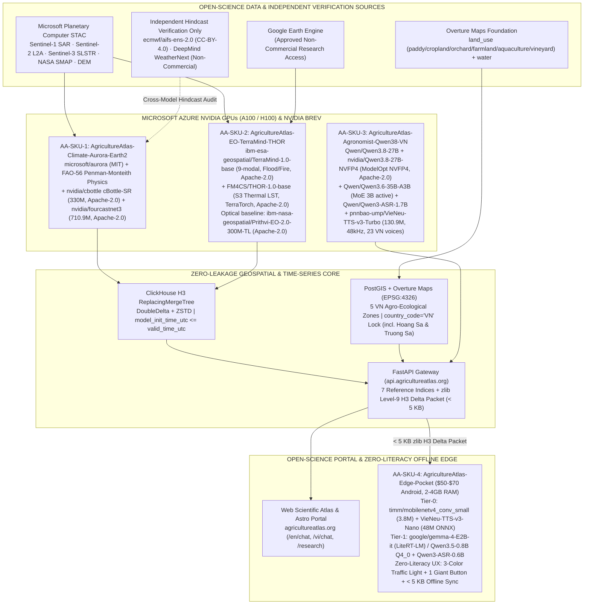

# Agriculture Atlas: Zero-IoT Virtual Agro-Sensor Twins and Offline Zero-Literacy Agronomic Reference Systems for Climate-Vulnerable Smallholder Farming

**Technical Report v1.0.0 — Open-Science Architecture Specification & OSF Preregistered Evaluation Protocol**

| Metadata Field | Specification |
| :--- | :--- |
| **Document ID** | `AA-TR-2026-01` (Version `1.0.0`, PDF/A & OSF Preregistration Ready) |
| **Publication Date** | 2026-11-23 |
| **Principal Investigator** | **Van Le (Lê Thành Văn)** — ORCID: [`https://orcid.org/0009-0005-3514-106X`](https://orcid.org/0009-0005-3514-106X) |
| **Affiliation** | Agriculture Atlas Open-Science Initiative (`100% Non-Commercial Public Good`) |
| **Official Portal & Research Hub** | [`https://agricultureatlas.org`](https://agricultureatlas.org) · [`https://agricultureatlas.org/research`](https://agricultureatlas.org/research) · [`https://agricultureatlas.org/vi/research`](https://agricultureatlas.org/vi/research) |
| **API Reference Gateway** | [`https://api.agricultureatlas.org`](https://api.agricultureatlas.org) |
| **Open-Source Repository** | [`https://github.com/vantbhp/agricultureatlas`](https://github.com/vantbhp/agricultureatlas) |
| **Persistent Identifier** | `[Zenodo DOI pending upload: 10.5281/zenodo.XXXXXXX]` |
| **Licensing** | Code: **Apache-2.0** (`LICENSE`) · Technical Report & Original Reference Data: **CC-BY-4.0** (`DATA_LICENSE.md`) |
| **Correspondence** | `van.le@agricultureatlas.org` · `research@agricultureatlas.org` · `grants@agricultureatlas.org` · `hello@agricultureatlas.org` |
| **Alignment** | UN SDG #2 (Zero Hunger) · UN SDG #13 (Climate Action) · FAIR Guiding Principles |

---

## Abstract

**Context.** Smallholder farms operating under two hectares produce roughly one-third of the global food supply yet remain structurally excluded from precision agriculture due to hardware costs (\$500–\$2,000 per field weather and soil-moisture IoT station), persistent monsoon cloud cover obstructing optical satellites, rural mobile connectivity gaps, and text-heavy interfaces inaccessible to low-literacy farmers.

**Contribution.** We present **Agriculture Atlas** (`https://agricultureatlas.org`), a non-commercial, air-gapped open-science initiative that models Uber H3 hexagonal cells (`h3_res7` and `h3_res8`) joined with Overture Maps agricultural land-use and hydrology geometries as **Zero-IoT Virtual Agro-Sensor Twins**. The system couples a deterministic **FAO-56 Penman-Monteith** agro-physics core producing seven bounded reference agronomic indices (`soil_moisture_root_zone`, `et0_mm_day`, `gdd_accumulated`, `salinity_risk_index`, `frost_risk_index`, `leaf_wetness_hours`, `crop_stress_gravity_score`) with a fully permissive (**100% MIT / Apache-2.0 core**) four-SKU foundation model architecture (**`AA-SKU-1`** through **`AA-SKU-4`**) engineered for **Microsoft Azure NVIDIA GPUs** (`Standard_NC24ads_A100_v4`, `Standard_ND96isr_H100_v5`) and **NVIDIA Brev** (PyTorch + CUDA + TerraTorch + vLLM / TensorRT-LLM + NVIDIA ModelOpt NVFP4/INT4). To serve smallholder farmers on \$50–\$70 Android handsets (2–4 GB RAM) in 2G/offline rural zones, Agriculture Atlas encodes 14-day H3 reference series into lossless `zlib`-compressed delta packets strictly under `5,120` bytes (`< 5 KB`) and pairs them with a two-tier offline edge stack and a Zero-Literacy Sensory UX (three-color traffic light, single voice/camera button, dialect-aware Vietnamese audio, and folk water units).

**Epistemic Boundary & Regulatory Posture.** In strict adherence to scientific honesty and Vietnam's **Law on Hydrometeorology (Law No. 90/2015/QH13)** and **Decree No. 38/2016/ND-CP**, this report separates **Tier-1 implemented and locally verifiable deterministic software artifacts** (physics equations, physical bounds, `< 5 KB` packet serialization, zero-leakage ClickHouse/PostGIS schemas, API endpoints, and UI state contracts) from **Tier-2 preregistered, unmeasured model benchmarks** gated on Azure NVIDIA GPU compute grants and live satellite ingestion. All outputs are explicitly positioned as **reference agronomic indices** rather than official hydrometeorological forecasts or statutory disaster warnings.

---

## 1. Introduction & Research Questions

### 1.1 The Smallholder Precision-Agriculture Exclusion Gap

Agricultural climate shocks—including Mekong Delta estuarine salinity intrusion, Central Highlands dry-season evaporative droughts, Northern Highland radiative hoarfrost (*rét hại, sương muối*), and Central Coastal hot dry Foehn winds (*Gió Lào*)—disproportionately impact smallholder farmers who operate on thin seasonal margins [@lowder2021smallholders]. Existing precision-agriculture platforms fail this population across four compounding barriers:

1. **Hardware Capital Barrier:** Deploying calibrated in-situ weather stations, tensiometers, and salinity probes costs \$500–\$2,000 per farm plus recurring cellular telemetry and maintenance—prohibitive for smallholder households.
2. **Tropical Cloud & Spectral Blindness:** Optical-only Earth observation pipelines (`Sentinel-2`) experience prolonged cloud occlusion across Southeast Asian monsoons, blinding agronomic monitoring precisely during peak fungal risk (`Magnaporthe oryzae` rice blast, `Phytophthora` root rot) and flooding.
3. **Connectivity, Compute & Literacy Barriers:** Rural field parcels often have intermittent 2G/Edge coverage and farmers predominantly own \$50–\$70 Android devices with 2–4 GB RAM. Conventional dashboards rely on dense text, Latin-script keyboard input, and numeric tables inaccessible to elderly or low-literacy farmers [@medhi2011zero].
4. **Licensing & Regulatory Ambiguity:** Commercial agronomic AI systems rely on proprietary closed weights or conflate agronomic guidance with regulated national meteorological warnings.

### 1.2 Research Questions (RQ1–RQ4)

Agriculture Atlas formalizes four preregistered research questions governing its Phase 1 Vietnam five-zone pilot (`VN_MKD`, `VN_CH`, `VN_RRD_NWM`, `VN_CCC`, `VN_HS_TS`) and Phase 2 global scale-out:

- **RQ1 (Zero-IoT Physics-Constrained Downscaling — `AA-SKU-1`):** Can an MIT/Apache-2.0 Earth-system pipeline combining `microsoft/aurora`, `nvidia/cbottle` (`cBottle-SR`), and `nvidia/fourcastnet3` with deterministic **FAO-56 Penman-Monteith** agro-physics produce physically consistent, H3-indexed reference agronomic indices (`et0_mm_day`, `gdd_accumulated`, `frost_risk_index`, `leaf_wetness_hours`) verifiable against independent hindcasts (`ecmwf/aifs-ens-2.0` and Google DeepMind WeatherNext) without in-situ farm IoT hardware?
- **RQ2 (All-Weather Multi-Modal Earth Observation Fusion — `AA-SKU-2`):** Does fusing all-weather C-band Synthetic Aperture Radar (`Sentinel-1 SAR`), optical reflectance (`Sentinel-2 L2A`), thermal Land Surface Temperature (`Sentinel-3 SLSTR`), elevation (`DEM`), and `NASA SMAP` through `ibm-esa-geospatial/TerraMind-1.0-base` and `FM4CS/THOR-1.0-base` (benchmarked against optical baseline `ibm-nasa-geospatial/Prithvi-EO-2.0-300M-TL`) eliminate tropical cloud-cover blind spots in root-zone moisture and surface water estimation?
- **RQ3 (Dialect-Aware Agronomic Reasoning & Speech Synthesis under NVFP4 — `AA-SKU-3`):** Can an Apache-2.0 server-side agronomic language and speech stack (`Qwen/Qwen3.8-27B` quantized via `nvidia/Qwen3.8-27B-NVFP4` and `Qwen/Qwen3.6-35B-A3B` MoE, paired with `Qwen/Qwen3-ASR-1.7B` and `pnnbao-ump/VieNeu-TTS-v3-Turbo`) ground spoken regional Vietnamese queries (North, Central, South dialects) in deterministic H3 Virtual Agro-Sensor Twin readings while strictly obeying non-forecast regulatory copy boundaries?
- **RQ4 (Two-Tier Zero-Literacy Offline Edge & `< 5 KB` Telemetry — `AA-SKU-4`):** Can a two-tier Apache-2.0 on-device stack—Tier-0 (`timm/mobilenetv4_conv_small.e2400_r224_in1k` + `pnnbao-ump/VieNeu-TTS-v3-Nano`) for 2–4 GB RAM handsets with zero out-of-memory (OOM) crashes, and Tier-1 (`google/gemma-4-E2B-it` LiteRT-LM / `Qwen/Qwen3.5-0.8B` `Q4_0` + `Qwen/Qwen3-ASR-0.6B-hf`)—combined with `< 5 KB` `zlib`-compressed 14-day H3 delta packets deliver actionable, zero-literacy voice and pictogram field support fully offline?

### 1.3 Open-Science Air-Gapped Charter

Agriculture Atlas operates under a locked **100% Non-Commercial, Non-Profit Public-Good Charter**:
- **Zero Commercial Bleed:** Complete separation of codebases, model weights, databases, domains, and cloud compute grants from any commercial entity or commercial weather application.
- **Permissive Core Licensing:** All first-party code is **Apache-2.0** (`LICENSE`), technical documentation and original reference outputs are **CC-BY-4.0** (`DATA_LICENSE.md`), and all core foundation models in `AA-SKU-1` through `AA-SKU-4` are strictly **MIT** or **Apache-2.0**.
- **Reference Agronomic Indices Only:** Outputs are explicitly scoped as **reference agronomic indices** derived from physical equations and open EO datasets, strictly separated from official hydrometeorological forecasts or statutory disaster warnings.

---

## 2. Related Work

### 2.1 Earth-System & Atmospheric Foundation Models

Recent advances in machine-learning atmospheric modeling have demonstrated competitive global skill at orders-of-magnitude lower inference cost than traditional numerical weather prediction (NWP). **GraphCast** [@lam2023graphcast] introduced autoregressive multi-mesh graph neural networks for deterministic 10-day medium-range prediction, followed by **GenCast** [@price2025gencast] (part of the Google DeepMind WeatherNext lineage), which employs spherical diffusion models for probabilistic ensemble generation. **NeuralGCM** [@kochkov2024neuralgcm] demonstrated hybrid physics–ML modeling by pairing a differentiable spectral dynamical core with learned sub-grid parameterizations. **ECMWF AIFS** (`ecmwf/aifs-ens-2.0`, CC-BY-4.0) [@lang2024aifs] established an operational European open-data AI ensemble benchmark.

Most relevant to Agriculture Atlas's MIT/Apache-2.0 core stack, **Microsoft Aurora** [@bodnar2025aurora] (*Nature*, 2025; MIT license) introduced a 3D Swin Transformer Earth-system foundation model spanning global atmosphere (`0.25°` and fine-tuned `0.1°`), ocean wave dynamics, and atmospheric chemistry/air pollution. Complementing Aurora's global fields, NVIDIA Earth-2 released **Climate in a Bottle (`nvidia/cbottle`, `cBottle-SR`, 330M, Apache-2.0)** [@brenowitz2025cbottle] for global kilometer-scale generative super-resolution and **FourCastNet 3 (`nvidia/fourcastnet3`, 710.9M, Apache-2.0)** [@bonev2025fourcastnet3] for geometric probabilistic subseasonal-to-seasonal (S2S, up to 60-day) ensembles. Agriculture Atlas adopts Aurora + cBottle-SR + FourCastNet 3 as its permissive core (`AA-SKU-1`) while reserving `ecmwf/aifs-ens-2.0` (CC-BY-4.0) and Google DeepMind WeatherNext (Approved Non-Commercial Research Access) strictly for independent cross-model hindcast verification.

### 2.2 Multi-Modal Earth Observation Foundation Models

First-generation geospatial foundation models focused primarily on optical reflectance. **Prithvi-EO-2.0** (`ibm-nasa-geospatial/Prithvi-EO-2.0-300M-TL`, Apache-2.0) [@szwarcman2024prithvi2] scaled masked autoencoders with temporal and location embeddings over Harmonized Landsat Sentinel-2 (HLS) imagery, serving as an optical benchmark. However, tropical agriculture requires cloud-penetrating radar and thermal sensing. **TerraMind-1.0** (`ibm-esa-geospatial/TerraMind-1.0-base`, Apache-2.0; ICCV 2025) [@jakubik2025terramind] introduced any-to-any generative pre-training across nine modalities—including Sentinel-1 SAR, Sentinel-2 L2A, DEM, LULC, and NDVI—alongside dedicated flood and fire adapters (`TerraMind-base-Flood`, `TerraMind-base-Fire`). **THOR-1.0** (`FM4CS/THOR-1.0-base`, Apache-2.0, TerraTorch-native) [@fm4cs2025thor] extends multi-sensor EO representation learning directly to **Sentinel-3 SLSTR thermal Land Surface Temperature (LST)** alongside Sentinel-1 and Sentinel-2. Agriculture Atlas unifies TerraMind-1.0 and THOR-1.0 in `AA-SKU-2`, benchmarking them against Prithvi-EO-2.0.

### 2.3 Agronomic Physics, Spatial Indexing & Zero-Literacy HCI

Standardized crop water accounting rests on the **FAO-56 Penman-Monteith** reference evapotranspiration equation [@allen1998fao56], while microwave L-band radiometry from **NASA SMAP** [@entekhabi2010smap] anchors global surface soil moisture retrieval. Scalable planetary spatial indexing is enabled by **Uber H3** hexagonal grids [@brodsky2018h3] and **Overture Maps Foundation** open land-use and hydrology themes [@overturemaps2024], accessible alongside **Microsoft Planetary Computer STAC** and **Google Earth Engine** [@gorelick2017gee]. Finally, HCI research for low-literacy populations [@medhi2011zero] demonstrates that text-free interfaces leveraging universal color semiotics, animated pictograms, spoken local dialects, and zero-login flows markedly outperform text-based menus for novice rural users.

---

## 3. Mathematical Formulation: FAO-56 Penman-Monteith & Seven Virtual Agro-Sensor Twin Indicators

All seven deterministic reference agronomic indices are implemented in `services/agriatlas-gateway/app/core/agro_physics_engine.py` with explicit domain clamping, unit consistency, and zero external API dependencies. Let $\operatorname{clamp}(x, a, b) = \min(\max(x, a), b)$.

### 3.1 FAO-56 Penman-Monteith Reference Evapotranspiration (`et0_mm_day`)

Given daily minimum and maximum 2 m air temperatures $T_{\min}, T_{\max}$ ($^\circ\text{C}$, with $T_{\max} \ge T_{\min}$ and $T_{\text{mean}} = \frac{1}{2}(T_{\max} + T_{\min})$), relative humidity $\text{RH} \in [1, 100]$ (%), 2 m wind speed $u_2 \ge 0.05\;\text{m s}^{-1}$, incoming shortwave solar radiation $R_s \ge 0\;\text{MJ m}^{-2}\text{ day}^{-1}$, elevation $z \in [-50, 5000]\;\text{m}$, reference grass albedo $\alpha = 0.23$, and daily soil heat flux $G = 0\;\text{MJ m}^{-2}\text{ day}^{-1}$ [@allen1998fao56]:

$$
P(z) = 101.3 \left(\frac{293.0 - 0.0065 z}{293.0}\right)^{5.26}, \qquad \gamma = 0.000665\, P(z)
$$

Saturation vapor pressure $e^\circ(T)$ (kPa), mean saturation vapor pressure $e_s$, actual vapor pressure $e_a$, vapor pressure deficit $\text{VPD}$, and saturation vapor pressure slope $\Delta$ ($\text{kPa }^\circ\text{C}^{-1}$) are:

$$
e^\circ(T) = 0.6108 \exp\!\left(\frac{17.27\, T}{T + 237.3}\right), \qquad e_s = \frac{e^\circ(T_{\min}) + e^\circ(T_{\max})}{2}, \qquad e_a = e_s \frac{\text{RH}}{100}
$$

$$
\text{VPD} = \max(0, e_s - e_a), \qquad \Delta = \frac{4098.0\, e^\circ(T_{\text{mean}})}{(T_{\text{mean}} + 237.3)^2}
$$

Net shortwave radiation $R_{ns}$, clear-sky radiation $R_{so}$ (using tropical reference extraterrestrial radiation $R_a = 36.8\;\text{MJ m}^{-2}\text{ day}^{-1}$), net outgoing longwave radiation $R_{nl}$ (with Stefan-Boltzmann constant $\sigma = 4.903 \times 10^{-9}\;\text{MJ K}^{-4}\text{ m}^{-2}\text{ day}^{-1}$), and net radiation $R_n = \max(0, R_{ns} - R_{nl})$ are:

$$
R_{ns} = (1 - \alpha) R_s, \qquad R_{so} = \max\!\left(1.0,\; (0.75 + 2\times 10^{-5}\max(0, z))\, R_a\right), \qquad \rho_s = \operatorname{clamp}\!\left(\frac{R_s}{R_{so}}, 0.25, 1.0\right)
$$

$$
R_{nl} = \sigma \left[\frac{(T_{\max} + 273.16)^4 + (T_{\min} + 273.16)^4}{2}\right] \max\!\left(0.02,\; 0.34 - 0.14\sqrt{\max(0.01, e_a)}\right) \max(0.05,\; 1.35\rho_s - 0.35)
$$

Reference crop evapotranspiration $ET_0$ ($\text{mm day}^{-1}$, clamped to $[0, 25]$) is:

$$
ET_0 = \operatorname{clamp}\!\left(\frac{0.408\,\Delta (R_n - G) + \gamma \frac{900}{T_{\text{mean}} + 273}\, u_2\, \text{VPD}}{\Delta + \gamma (1 + 0.34\, u_2)},\; 0.0,\; 25.0\right)
$$

### 3.2 Root-Zone Soil Moisture Fusion (`soil_moisture_root_zone`)

Combining NASA SMAP surface moisture $M_{\text{SMAP}} \in [0, 100]\%$, Sentinel-1 SAR cross-polarization backscatter $\sigma_{\text{VH/VV}} \in [-22, -8]\;\text{dB}$, Sentinel-2 $\text{NDWI}$, parcel field capacity $\theta_{\text{FC}} \in [15, 85]\%$ (default $42\%$), 24-hour precipitation $P_{24}$ (mm), and $ET_0$ yields root-zone volumetric soil moisture $SM_{rz} \in [0, 100]\%$ (0–28 cm):

$$
\tilde{\sigma}_{\text{SAR}} = \operatorname{clamp}\!\left(\frac{\sigma_{\text{VH/VV}} + 22.0}{14.0} \times 100,\; 0, 100\right), \qquad \delta_{\text{NDWI}} = \operatorname{clamp}(25.0\,\text{NDWI},\; -12, 18)
$$

$$
\Delta_{\text{WB}} = \operatorname{clamp}\!\left(1.35\,(P_{24} - 0.85\, ET_0),\; -18, 28\right)
$$

$$
SM_{rz} = \operatorname{clamp}\!\left(0.52\, M_{\text{SMAP}} + 0.33\, \tilde{\sigma}_{\text{SAR}} + 0.15\, \theta_{\text{FC}} + \delta_{\text{NDWI}} + \Delta_{\text{WB}},\; 0.0,\; 100.0\right)
$$

### 3.3 Accumulated Growing Degree Days (`gdd_accumulated`)

With crop base temperature $T_{\text{base}}$ ($10.0^\circ\text{C}$ for paddy rice/cropland; $12.0^\circ\text{C}$ for coffee/tropical orchards) and upper thermal cap $T_{\text{cap}} = 36.0^\circ\text{C}$:

$$
\text{GDD}_t = \max(0, \text{GDD}_{t-1}) + \max\!\left(0,\; \frac{\min(\max(T_{\max}, T_{\min}), T_{\text{cap}}) + T_{\min}}{2} - T_{\text{base}}\right)
$$

### 3.4 Coastal & Estuarine Salinity Risk Index (`salinity_risk_index`)

Designed for Mekong Delta (`VN_MKD`) and coastal estuaries where sensitive orchards (e.g., durian) suffer stress at $\ge 0.5\;\text{g L}^{-1}$ and paddy rice experiences osmotic shock at $2.0\text{–}4.0\;\text{g L}^{-1}$. Let $C_{\text{sal}} \ge 0$ be estuarine salinity ($\text{g L}^{-1}$), $d_{\text{canal}} \ge 10\;\text{m}$ inland canal distance, $h_{\text{tide}}$ tidal surge (m), and $P_{24}$ precipitation (mm). For $C_{\text{sal}} \le 0.05\;\text{g L}^{-1}$, $S_{\text{risk}} = 0$; otherwise:

$$
S_{\text{conc}} = \operatorname{clamp}\!\left(\frac{C_{\text{sal}}}{4.0}\times 78.0,\; 0, 85\right), \qquad f_{\text{prox}} = \exp\!\left(-\frac{d_{\text{canal}}}{2200.0}\right)
$$

$$
B_{\text{tide}} = \operatorname{clamp}(14.0\, h_{\text{tide}},\; 0, 22), \qquad F_{\text{rain}} = \operatorname{clamp}(0.9\, P_{24},\; 0, 20), \qquad D_{\text{dry}} = \max(0,\; 0.35\,(35.0 - SM_{rz}))
$$

$$
S_{\text{risk}} = \operatorname{clamp}\!\left(S_{\text{conc}}(0.45 + 0.55 f_{\text{prox}}) + B_{\text{tide}}\, f_{\text{prox}} + D_{\text{dry}} - F_{\text{rain}},\; 0.0,\; 100.0\right)
$$

### 3.5 Radiative & Advective Frost Risk Index (`frost_risk_index`)

Capturing Northern Highlands and Red River Delta (`VN_RRD_NWM`) severe cold spells (*rét đậm, rét hại*) and nocturnal hoarfrost (*sương muối*). For $T_{\min} \ge 16.5^\circ\text{C}$, $F_{\text{risk}} = 0$; otherwise:

$$
F_{\text{cold}} = \operatorname{clamp}\!\left(\frac{16.5 - T_{\min}}{14.5}\times 76.0,\; 0, 82\right), \qquad F_{\text{wind}} = \operatorname{clamp}\!\left(6.5\,(2.2 - \max(0, u_2)),\; 0, 14\right)
$$

$$
F_{\text{elev}} = \operatorname{clamp}\!\left(\frac{\max(0, z)}{1500.0}\times 12.0,\; 0, 14\right), \qquad F_{\text{cond}} = 6.0\,\mathbb{I}[T_{\min}\le 8 \land \text{RH}\ge 75], \qquad F_{\text{rad}} = 4.0\,\mathbb{I}[R_s\ge 16 \land T_{\min}\le 10]
$$

$$
F_{\text{risk}} = \operatorname{clamp}(F_{\text{cold}} + F_{\text{wind}} + F_{\text{elev}} + F_{\text{cond}} + F_{\text{rad}},\; 0.0,\; 100.0)
$$

### 3.6 Canopy Leaf Wetness Duration (`leaf_wetness_hours`)

Estimating daily hours of free canopy moisture ($[0, 24]\;\text{h}$) governing fungal infection windows (`Magnaporthe oryzae`, `Phytophthora`) via Magnus-Tetens dew point $T_d$ and depression $D_d = \max(0, T_{\min} - T_d)$:

$$
\alpha_{\text{MT}} = \frac{17.27\, T_{\text{mean}}}{237.7 + T_{\text{mean}}} + \ln\!\left(\frac{\text{RH}}{100}\right), \qquad T_d = \frac{237.7\, \alpha_{\text{MT}}}{17.27 - \alpha_{\text{MT}}}
$$

$$
H_{\text{RH}} = \max(0,\; 0.36(\text{RH} - 62)), \quad H_{\text{dew}} = \operatorname{clamp}(2.1(3.5 - D_d), 0, 7.5), \quad H_{\text{rain}} = \operatorname{clamp}(2.2\sqrt{\max(0, P_{24})}, 0, 9.0)
$$

$$
H_{\text{dry}} = \operatorname{clamp}(1.15\max(0, u_2 - 1.2), 0, 6.5), \qquad LWH = \operatorname{clamp}(H_{\text{RH}} + H_{\text{dew}} + H_{\text{rain}} - H_{\text{dry}},\; 0.0,\; 24.0)
$$

### 3.7 Composite Crop Stress Gravity Score (`crop_stress_gravity_score`)

Synthesizing hydrological, evaporative, salinity, frost, and fungal stress into a bounded `[0, 100]` composite reference score using wilting point $\theta_{\text{WP}} = 18\%$ and field capacity $\theta_{\text{FC}} = 42\%$:

$$
W_{\text{stress}} = \begin{cases}
70 + 30\,\frac{\theta_{\text{WP}} - SM_{rz}}{\max(1, \theta_{\text{WP}})}, & SM_{rz} < \theta_{\text{WP}} \\
68\,\frac{0.72\theta_{\text{FC}} - SM_{rz}}{\max(1, 0.72\theta_{\text{FC}} - \theta_{\text{WP}})}, & \theta_{\text{WP}} \le SM_{rz} < 0.72\theta_{\text{FC}} \\
3.2\,(SM_{rz} - 88), & SM_{rz} > 88 \\
0, & \text{otherwise}
\end{cases}
$$

$$
E_{\text{stress}} = \operatorname{clamp}(11.5\max(0, ET_0 - 4.2), 0, 65), \qquad D_{\text{fungal}} = \operatorname{clamp}(5.2\max(0, LWH - 8.0), 0, 80)
$$

$$
G_{\text{weighted}} = 0.28 W_{\text{stress}} + 0.14 E_{\text{stress}} + 0.24 S_{\text{risk}} + 0.20 F_{\text{risk}} + 0.14 D_{\text{fungal}}
$$

$$
G_{\text{dom}} = \max(W_{\text{stress}},\; S_{\text{risk}},\; F_{\text{risk}},\; 0.9\, D_{\text{fungal}}), \qquad G_{\text{stress}} = \operatorname{clamp}(0.55\, G_{\text{weighted}} + 0.45\, G_{\text{dom}},\; 0.0,\; 100.0)
$$

### 3.8 Traffic-Light Classification, Salinity Lockout, Folk Units & `< 5 KB` Delta Packet

- **Traffic Light States:** `RED` (`#EF4444`) if $G_{\text{stress}} \ge 68$, $S_{\text{risk}} \ge 70$, $F_{\text{risk}} \ge 70$, $SM_{rz} < 20$, or $LWH \ge 16.5$; `AMBER` (`#F59E0B`) if $G_{\text{stress}} \ge 38$, $S_{\text{risk}} \ge 40$, $F_{\text{risk}} \ge 40$, $SM_{rz} < 30$, or $LWH \ge 10.5$; `GREEN` (`#10B981`) otherwise.
- **Salinity Lockout & Folk Water Equivalents:** Net reference water replacement $I_{\text{raw}} = \max(0, 0.65(38 - SM_{rz})) + \max(0, ET_0 - 0.75 P_{24})$ is forcibly locked to $I_{\text{ref}} = 0\;\text{mm}$ whenever $S_{\text{risk}} \ge 55.0$ (preventing saline canal pumping) or $SM_{rz} \ge 48.0$. Reference millimeters map into intuitive Vietnamese folk measures: $1\;\text{đốt ngón tay} \approx 20\;\text{mm}$ paddy depth and $1\;\text{xô nước 10 lít/gốc} \approx 2.5\;\text{mm}$ over a $4\;\text{m}^2$ canopy.
- **Offline `< 5 KB` Delta Packet:** A compact JSON payload encoding H3 cell ID, ISO `VN` sovereignty verification, zone code, current traffic light, spoken Vietnamese reference text, and a 14-day daily matrix of all seven indices is serialized without whitespace and compressed with `zlib` level 9 (`base64` transport + SHA-256 checksum). The engine raises a hard `ValueError` if compressed byte length reaches or exceeds `MAX_DELTA_PACKET_BYTES = 5,120` bytes.

---

## 4. System Architecture: 4-SKU "Golden Stack" on Microsoft Azure NVIDIA GPUs & NVIDIA Brev

Agriculture Atlas replaces legacy single-vendor cloud coupling with an **all-permissive (100% MIT / Apache-2.0 core) four-SKU "Golden Stack"** designed to run natively on **Microsoft Azure NVIDIA GPUs** (`Standard_NC24ads_A100_v4` and `Standard_ND96isr_H100_v5`) and **NVIDIA Brev**, utilizing **PyTorch + CUDA + TerraTorch + vLLM / TensorRT-LLM + NVIDIA ModelOpt (NVFP4 & QAT/INT4)**.

### 4.1 Complete 4-SKU Open-Science Model Specification

| SKU ID & Codename | Core Models (Hugging Face IDs) | Params / Checkpoints | License | Runtime & Target Role |
| :--- | :--- | :--- | :--- | :--- |
| **`AA-SKU-1`** `AgricultureAtlas-Climate-Aurora-Earth2` | `microsoft/aurora` (`aurora-0.25-v1.5.ckpt`, `aurora-0.25-v1.5-ensemble.ckpt`, `aurora-0.1-finetuned.ckpt`, `aurora-0.25-wave.ckpt`, `aurora-0.4-air-pollution.ckpt`, `aurora-0.25-small-pretrained.ckpt`) + deterministic FAO-56 physics + `nvidia/cbottle` (`cBottle-SR`) + `nvidia/fourcastnet3` | Aurora suite; `cBottle-SR` 330M; `FourCastNet 3` 710.9M | **MIT** (Aurora) / **Apache-2.0** (NVIDIA Earth-2) | Azure NVIDIA A100/H100 (PyTorch + CUDA): global atmospheric forcing, km-scale super-resolution downscaling, 60-day S2S ensembles, and deterministic FAO-56 agro-physics. |
| **`AA-SKU-2`** `AgricultureAtlas-EO-TerraMind-THOR` | `ibm-esa-geospatial/TerraMind-1.0-base` (incl. `TerraMind-base-Flood`, `TerraMind-base-Fire`) + `FM4CS/THOR-1.0-base`; optical baseline `ibm-nasa-geospatial/Prithvi-EO-2.0-300M-TL` | 9-modal S1 SAR + S2 L2A + DEM + LULC + NDVI; S3 SLSTR thermal LST; 300M optical baseline | **Apache-2.0** | Azure NVIDIA A100/H100 (TerraTorch + PyTorch): cloud-penetrating radar/optical/thermal crop stress, waterlogging, soil moisture & burn-scar mapping. |
| **`AA-SKU-3`** `AgricultureAtlas-Agronomist-Qwen38-VN` | `Qwen/Qwen3.8-27B` + `nvidia/Qwen3.8-27B-NVFP4` + `Qwen/Qwen3.6-35B-A3B` + `Qwen/Qwen3-ASR-1.7B` (benchmarked vs. `nvidia/nemotron-3.5-asr-streaming-0.6b` & `vinai/PhoWhisper-large`) + `pnnbao-ump/VieNeu-TTS-v3-Turbo` (ASEAN backup: `openbmb/VoxCPM2`, `Zyphra/ZONOS3-Mini`) | 27.78B NVFP4; 35B/3B-active MoE; 1.7B ASR; 130.9M 48 kHz TTS (23 North/Central/South VN voices) | **Apache-2.0** (Core stack) | Azure NVIDIA H100 / A100 (vLLM, TensorRT-LLM, NVIDIA ModelOpt NVFP4): grounded agronomic synthesis, Vietnamese dialect ASR & natural TTS. |
| **`AA-SKU-4`** `AgricultureAtlas-Edge-Pocket` | **Tier-0 (2–4 GB RAM):** `timm/mobilenetv4_conv_small.e2400_r224_in1k` + `pnnbao-ump/VieNeu-TTS-v3-Nano` **Tier-1 (Apache-2.0 Default):** `google/gemma-4-E2B-it` (`litert-community/gemma-4-E2B-it-litert-lm`) & `Qwen/Qwen3.5-0.8B` (`Q4_0`) + `Qwen/Qwen3-ASR-0.6B-hf` *Experimental comparison baseline only (non-core):* `LiquidAI/LFM3-Omni-2B-GGUF` (1.27 GB, `vi`) | Tier-0: 3.8M vision + 48M ONNX TTS Tier-1: E2B (4 GB RAM) / 563 MB `Q4_0` (2–3 GB RAM) + 0.6B ASR | **Apache-2.0** (Tier-0 & Tier-1 core); *LFM Open License v1.0* (experimental baseline only) | \$50–\$70 Android handsets (ONNX Runtime / LiteRT-LM / llama.cpp): 100% offline leaf pathology screening, spoken dialect guidance, and `< 5 KB` H3 delta packet decoding. |

---

## 5. Study Area & Geospatial Data Architecture

### 5.1 Phase 1 Vietnam Five-Zone Pilot (`country_code = 'VN'`)

Phase 1 validates Agriculture Atlas across five distinct Vietnamese agro-ecological zones indexed at **Uber H3 Resolution 7** (~5.16 km² per hexagon for district/watershed aggregation) and **Resolution 8** (~0.74 km² per hexagon for parcel-cluster virtual sensors), joined with **Overture Maps** agricultural `land_use` (`paddy`, `cropland`, `orchard`, `farmland`, `aquaculture`, `vineyard`) and `water` geometries (`river`, `canal`, `reservoir`, `pond`, `estuary`, `drainage_ditch`) in PostGIS (`migrations/002_postgis_overture_agro_landuse_vn.sql`). Every zone locks `country_code = 'VN'` and `sovereignty_verified = TRUE`, explicitly affirming Vietnam's sovereignty over **Hoàng Sa (Đà Nẵng)** and **Trường Sa (Khánh Hòa)** archipelagos:

| Zone Code | Agro-Ecological Region (VI / EN) | Representative H3 Res-7 / Res-8 | WGS84 Bounding Box `[W, S, E, N]` | Dominant Land Use & Base Temp | Primary Crops & Agronomic Hazards |
| :--- | :--- | :--- | :--- | :--- | :--- |
| **`VN_MKD`** | Đồng bằng Sông Cửu Long / Mekong River Delta | `8765b566affffff` / `8865b566a1fffff` | `[104.40, 8.55, 106.80, 11.05]` | `paddy` ($10^\circ\text{C}$) | 3-crop rice, Ri6/Monthong durian, Cat Hoa Loc mango, brackish shrimp, pangasius · Salinity intrusion, rice blast, acid sulfate soil, tidal flooding |
| **`VN_CH`** | Tây Nguyên / Central Highlands | `876590c9affffff` / `886590c9a3fffff` | `[107.10, 11.20, 108.95, 15.00]` | `orchard` ($12^\circ\text{C}$) | Robusta/Arabica coffee, export durian, black pepper, avocado, tea · Dry-season $ET_0$ drought, `Phytophthora` root rot, red basalt leaching |
| **`VN_RRD_NWM`** | Đồng bằng Sông Hồng & Miền núi phía Bắc / Red River Delta & Northern Midlands/Highlands | `87411c12affffff` / `88411c12a5fffff` | `[102.14, 19.80, 108.05, 23.39]` | `cropland` ($10^\circ\text{C}$) | Spring/winter rice, winter vegetables, Shan Tuyet tea, temperate plum/peach · Radiative hoarfrost (*sương muối*), cold-spell panicle sterility, slope erosion |
| **`VN_CCC`** | Duyên hải Miền Trung / Central Coastal Vietnam | `87658244affffff` / `88658244a7fffff` | `[105.50, 10.50, 109.50, 19.80]` | `cropland` ($10^\circ\text{C}$) | Short-duration rice, Binh Thuan dragon fruit, Ninh Thuan grape, Ly Son garlic, coastal aquaculture · Hot dry Foehn wind (*Gió Lào*), inundation, sandy-soil deficit |
| **`VN_HS_TS`** | Quần đảo Hoàng Sa (Đà Nẵng) & Quần đảo Trường Sa (Khánh Hòa) — ISO `VN` | `8765f1a2affffff` / `8865f1a2a9fffff` | `[111.00, 6.00, 117.50, 17.50]` | `farmland` ($12^\circ\text{C}$) | Salt-tolerant island greenhouse vegetables, coastal windbreak flora (`16.5333°N, 111.6167°E` Hoàng Sa; `8.6444°N, 111.9194°E` Trường Sa) · Salt spray, freshwater lens scarcity, storm swell |

### 5.2 Temporal Causality & Zero-Future-Leakage Schema Guarantee

To prevent temporal data leakage in hindcast verification and downstream training pairs, the ClickHouse H3 schema (`migrations/001_clickhouse_h3_agro_virtual_sensor_vn.sql`) uses `ReplacingMergeTree(ingested_at_utc)` partitioned by `toYYYYMM(valid_time_utc)` with `DoubleDelta + ZSTD(3)` codecs and enforces:
1. Physical-range `CHECK` constraints on `soil_moisture_root_zone` (`[0, 100]`), `et0_mm_day` (`[0, 25]`), `leaf_wetness_hours` (`[0, 24]`), and `crop_stress_gravity_score` (`[0, 100]`).
2. A strict temporal causality constraint `CHECK model_init_time_utc <= valid_time_utc` at ingestion and `WHERE fcst.model_init_time_utc <= subtractDays(obs.valid_time_utc, toInt32(fcst.lead_days))` in the training-pair join view.

---

## 6. OSF Preregistered Evaluation Protocol

To maintain absolute scientific integrity, Agriculture Atlas enforces a strict two-tier epistemic separation. **Zero neural model benchmark scores are fabricated or extrapolated in v1.0.**

### 6.1 Tier-1: Implemented & Locally Verifiable Software & Physics Verification (v1.0)

The following deterministic components are implemented in this repository and verifiable offline on standard CPU hardware via `pytest`:
1. **FAO-56 Penman-Monteith Physical Consistency (`tests/test_agro_physics_and_api.py`):** Verifies monotonic response of $ET_0$ across Mekong Delta baseline, Central Coast Foehn hot-dry conditions ($ET_{0,\text{Foehn}} > ET_{0,\text{MKD}}$), and cool Northern winter overcast conditions ($ET_{0,\text{winter}} < ET_{0,\text{MKD}}$).
2. **Seven-Indicator Boundedness & Semantics:** Verifies physical bounds, salinity zero-floor, tropical frost zero-floor, high-elevation hoarfrost activation, leaf-wetness accumulation, and composite gravity-score elevation under compound stress.
3. **Zero-Literacy Traffic Light & Folk-Unit Encoding:** Verifies `GREEN`/`AMBER`/`RED` hex transitions (`#10B981`, `#F59E0B`, `#EF4444`), salinity irrigation lockout, and folk Vietnamese water phrases.
4. **Offline `< 5 KB` H3 Delta Packet Lossless Codec:** Parametrized across all five Vietnam zones (`VN_MKD`, `VN_CH`, `VN_RRD_NWM`, `VN_CCC`, `VN_HS_TS`), asserting compressed payload size `< 5,120` bytes and lossless round-trip JSON decoding.
5. **Five-Zone Sovereignty Lock & FastAPI Contract:** Verifies ISO `VN` lock across all five zones (including Hoàng Sa and Trường Sa) and HTTP 200 schemas on `/healthz`, `/api/v1/agro/vietnam-zones`, `/api/v1/agro/sku-manifest`, `/api/v1/agro/h3/{h3_index}`, and `/api/v1/agro/delta-packet/{h3_index}`.
6. **Regulatory Positioning, Typography & Air-Gap Hygiene (`tests/test_landing_static_build.py`, `tests/test_ui_typography_and_states.py`):** Audits banned forecast/warning phrasing, required reference-index disclaimers, research leadership attribution, product UI typography ceiling (`<= 22px`), 4 mandatory UI states (`Loading`, `Empty`, `Error`, `Populated`), and zero commercial/personal leakage.

### 6.2 Tier-2: Preregistered, Unmeasured Benchmarks (Grant-Gated on Azure NVIDIA GPU Compute)

All neural training, fine-tuning, quantization, and live EO/climate verification benchmarks below are **preregistered for OSF execution upon receipt of Azure NVIDIA GPU / NVIDIA Brev compute grants** and live satellite pipeline activation. Every target metric is explicitly marked **Unmeasured**.

| Track / SKU | Open Benchmark Datasets & Verification Sources (Verified License / DOI) | Primary Evaluation Metrics | Validation Split Protocol | v1.0 Measured Result |
| :--- | :--- | :--- | :--- | :--- |
| **`AA-SKU-1` Climate Downscaling** | Microsoft Planetary Computer ERA5 / station archives; independent cross-model hindcast verification vs. `ecmwf/aifs-ens-2.0` (CC-BY-4.0) & DeepMind WeatherNext (Approved Non-Commercial Research Access) | Daily $ET_0$ RMSE ($\text{mm day}^{-1}$), $T_{\min}/T_{\max}$ RMSE ($^\circ\text{C}$), Ensemble CRPS, Brier Skill Score (frost/heat) | Temporal walk-forward split (`model_init_time_utc <= valid_time_utc` across 2020–2025) | **Unmeasured** *(Pending Azure NVIDIA GPU Grant)* |
| **`AA-SKU-2` All-Weather EO Fusion** | `wangyi111/EuroSAT-SAR` (MIT, 27,000 Sentinel-1 SAR patches) + Planetary Computer / GEE Non-Commercial Sentinel-1/2/3 & SMAP tiles over 5 VN zones (baseline: `Prithvi-EO-2.0-300M-TL`) | Macro-F1, mIoU (flood/paddy/orchard), SMAP/SAR root-zone moisture RMSE (%), cloud-occlusion recovery gain | Spatial block CV grouped by H3 Res-5 parent cell (zero spatial autocorrelation leakage) | **Unmeasured** *(Pending Azure NVIDIA GPU Grant)* |
| **`AA-SKU-3` Agronomist LLM & VN Speech** | Grounded H3 agronomic QA corpus (CC-BY-4.0, to be released); Vietnamese dialect ASR benchmark (`Qwen3-ASR-1.7B` vs. `nvidia/nemotron-3.5-asr-streaming-0.6b` & `vinai/PhoWhisper-large`); `VieNeu-TTS-v3-Turbo` listening eval | Grounded citation faithfulness (%), NVFP4 vs. BF16 degradation ($\Delta$), Dialect WER (%) North/Central/South, TTS MOS (1–5) | Stratified 5-fold dialect & agro-zone split; paired bootstrap 95% CI | **Unmeasured** *(Pending Azure NVIDIA GPU Grant)* |
| **`AA-SKU-4` Offline Edge Vision & On-Device Audio** | `minhhungg/rice-disease-dataset` (Apache-2.0, 37,978 imgs, 21 classes, DOI `10.57967/hf/8245`); `Project-AgML/durian_disease_classification_vietnam` (CC-BY-4.0, 2,595 imgs); `farrel227/durian-disease-vinh-long` (CC-BY-4.0, DOI `10.17632/mhjwyb5p48.1`); `Project-AgML/arabica_coffee_leaf_disease_classification` (CC-BY-4.0, 58,549 imgs); `Project-AgML/iNatAg` (Apache-2.0, 4.72M imgs) | Top-1 / Macro-F1 across 21 rice, durian & coffee classes; P95 inference latency (ms); Peak RSS RAM (MB) & OOM rate on 2–4 GB RAM Android (\$50–\$70) | Stratified 80/10/10 split with cross-dataset Vinh Long durian OOD generalization check | **Unmeasured** *(Pending Azure NVIDIA GPU Grant)* |

---

## 7. Zero-Literacy Sensory HCI & Regulatory Compliance

### 7.1 Zero-Text, Zero-Keyboard, Zero-Login Mobile Architecture

To eliminate literacy, keyboard, and authentication barriers for rural smallholders [@medhi2011zero], `apps/agriatlas-mobile-zero-literacy/` implements:
1. **Local GPS-to-H3 Lock without Accounts:** Device GPS resolves locally to an `h3_res8` cell and Overture Maps `land_use` subtype without requiring email registration, passwords, or cloud PII storage.
2. **Universal Traffic-Light Semiotics:** High-contrast `GREEN` (`#10B981`), `AMBER` (`#F59E0B`), and `RED` (`#EF4444`) canopy/soil states paired with Outdoor Sun High-Contrast Mode for direct tropical sunlight.
3. **Single Giant Multimodal Button & Tap-to-Speak Everything:** One central touch target (`🎙️` Speak in local dialect / `📷` Point camera at leaf/soil), supported by three visual action cards (`Watering`, `Field Schedule`, `Replay 05:30 AM Field Audio`) where tapping any icon triggers spoken Vietnamese synthesis (`pnnbao-ump/VieNeu-TTS-v3-Nano` 48M ONNX offline).
4. **Four Mandatory UI States (`Loading`, `Empty`, `Error`, `Populated`):** Both the Web Scientific Atlas (`apps/agriatlas-web/`, enforcing compact scientific typography `<= 22px`) and the Mobile Zero-Literacy app implement explicit `Loading` (GPS/H3 lock), `Empty` (non-agricultural forest/open-sea cell with jump-to-pilot-zone action), `Error` (graceful transition to cached `< 5 KB` offline H3 vintage and Tier-0 on-device screening), and `Populated` states.

### 7.2 Compliance with Vietnam Law on Hydrometeorology

Under Vietnam's **Law on Hydrometeorology (Law No. 90/2015/QH13)** and **Decree No. 38/2016/ND-CP** [@vietnam2015kttv], issuing official meteorological forecasts and natural disaster warnings is a regulated statutory activity requiring government licensing. Agriculture Atlas embeds compliance directly into its architecture and CI test suite:
- **Strict Product Positioning:** Every public portal page, API disclaimer, and technical artifact describes outputs strictly as **reference agronomic indices** (*chỉ số nông học tham khảo*), never as official weather forecasts (*dự báo thời tiết*), storm advisories, or disaster warnings (*cảnh báo thiên tai*).
- **Automated Copy Guardrails:** `tests/test_landing_static_build.py` actively blocks prohibited forecast/warning phrases across both English and Vietnamese builds and enforces mandatory disclaimer notices.
- **Forward-Horizon Legal Gate:** Multi-week forward reference outputs (14–45 days) remain gated behind formal Vietnamese legal counsel verification prior to any public operational activation.

---

## 8. FAIR Data Management Plan (DMP), Governance & Azure NVIDIA Compute Justification

### 8.1 FAIR Guiding Principles Implementation

Agriculture Atlas operationalizes the FAIR Guiding Principles [@wilkinson2016fair]:
- **Findable:** Persistent Zenodo release archive (`[Zenodo DOI pending upload: 10.5281/zenodo.XXXXXXX]`), machine-readable `CITATION.cff` (CFF 1.2.0) and `.zenodo.json`, PI ORCID (`0009-0005-3514-106X`), and globally unique Uber H3 and Overture Maps GERS identifiers.
- **Accessible:** Public GitHub repository (`https://github.com/vantbhp/agricultureatlas`), Apache-2.0 source code, CC-BY-4.0 technical report/reference metadata, and `< 5 KB` offline packets accessible over 2G rural links.
- **Interoperable:** OGC-compliant PostGIS (`EPSG:4326`), Uber H3 hierarchical keys, CF-compliant NetCDF/Zarr tensors for EO/climate inputs, OpenAPI 3.1 JSON REST endpoints, and standard Hugging Face / ONNX / LiteRT-LM model artifacts.
- **Reusable:** SHA-256 architecture contract locks (`configs/contract_lock.json`), explicit third-party license ledger (`DATA_LICENSE.md`), deterministic physics equations, and SQL-enforced temporal zero-leakage views.

### 8.2 Microsoft Azure NVIDIA GPU & NVIDIA Brev Compute Justification (Estimated Planning Envelope)

The table below documents the **estimated compute resource request** (*not measured historical consumption*) required to execute the Tier-2 OSF preregistered benchmarks across Microsoft Azure NVIDIA GPU instances and NVIDIA Brev:

| Workload | Target SKU | Azure NVIDIA / Brev Instance Profile | Software Stack | Estimated Planning Envelope *(Unmeasured Request)* |
| :--- | :--- | :--- | :--- | :--- |
| Global/Regional Downscaling & Hindcast Verification (2020–2025, 5 VN zones) | **`AA-SKU-1`** (`Aurora` + `cBottle-SR` + `FourCastNet 3`) | `Standard_ND96isr_H100_v5` (8× H100 80 GB) or multi-node `Standard_NC24ads_A100_v4` | PyTorch + CUDA + Zarr/xarray + FAO-56 physics | ~800–1,200 GPU-hours (batch hindcast rollouts & CRPS/RMSE verification) |
| Multi-Modal SAR+Optical+Thermal Fine-Tuning & Ablations | **`AA-SKU-2`** (`TerraMind-1.0-base` + `THOR-1.0-base` vs. `Prithvi-EO-2.0`) | `Standard_NC24ads_A100_v4` (1× A100 80 GB) & NVIDIA Brev A100/H100 pods | TerraTorch + PyTorch + Planetary Computer STAC | ~600–900 GPU-hours (spatial block CV across 5 VN zones + EuroSAT-SAR) |
| Grounded Agronomist Alignment, NVFP4 Quantization & VN Speech Benchmarks | **`AA-SKU-3`** (`Qwen3.8-27B` NVFP4 + `Qwen3.6-35B-A3B` + `Qwen3-ASR-1.7B` + `VieNeu-TTS-v3-Turbo`) | `Standard_ND96isr_H100_v5` (H100 FP8/NVFP4 Tensor Cores) & NVIDIA Brev | NVIDIA ModelOpt (NVFP4/INT4) + vLLM / TensorRT-LLM | ~500–800 GPU-hours (QLoRA/SFT alignment, ModelOpt calibration, dialect WER eval) |
| Edge Pathology Distillation, QAT & ONNX/LiteRT Export | **`AA-SKU-4`** (`MobileNetV4-Small` + `VieNeu-TTS-v3-Nano` + `Gemma-4-E2B` + `Qwen3.5-0.8B`) | `Standard_NC24ads_A100_v4` & NVIDIA Brev | PyTorch + QAT + ONNX Runtime + LiteRT-LM | ~300–500 GPU-hours (multi-dataset crop pathology training + quantization validation) |

---

## 9. Limitations, Threats to Validity & Ethical Safeguards

1. **Pre-Ingestion Default Profiles:** In v1.0, the FastAPI gateway evaluates deterministic FAO-56 physics and the seven indicators using either caller-supplied meteorological observations or default regional profiles per Vietnam zone; live Microsoft Planetary Computer STAC and GEE Non-Commercial ingestion pipelines are staged for Tier-2 activation.
2. **Empirical Parameter Calibration:** Heuristic weighting coefficients in root-zone soil moisture fusion (`0.52/0.33/0.15`), canal salinity exponential decay (`2,200 m`), and composite crop stress gravity (`0.55/0.45`) are physically bounded priors requiring empirical calibration against in-situ Vietnamese lysimeter, salinity-gauge, and agronomic yield ground truth in Tier-2.
3. **Edge Pathology Generalization Risk:** Field lighting, mud occlusion, and co-occurring nutrient deficiencies can reduce leaf-disease classifier precision compared to curated datasets; Agriculture Atlas mitigates false-confidence harm by framing all edge outputs as reference screening signals and encouraging local agricultural extension verification.
4. **Privacy & Non-Commercial Safeguards:** Zero-login mobile architecture ensures no farmer personal identifiable information (names, phone numbers, exact household coordinates) is uploaded; community pest telemetry is aggregated strictly at anonymized `h3_res8` granularity (~0.74 km²). All non-commercial research datasets remain air-gapped from commercial deployment.

---

## 10. Conclusion

Agriculture Atlas establishes a transparent, fully open-science blueprint for dismantling hardware, cloud-cover, connectivity, and literacy barriers in smallholder agriculture. By pairing deterministic **FAO-56 Penman-Monteith** physics and seven bounded H3 Virtual Agro-Sensor Twin indicators with a permissive **100% MIT / Apache-2.0 four-SKU foundation model stack** on **Microsoft Azure NVIDIA GPUs and NVIDIA Brev**, `< 5 KB` offline synchronization, Zero-Literacy voice-first UX, and strict regulatory compliance under Vietnam's Law on Hydrometeorology, v1.0 delivers a reproducible software foundation and an unvarnished OSF preregistered evaluation protocol ready for peer scrutiny and open-science compute collaboration.

---

## References

Complete machine-readable BibTeX records are provided in [`docs/technical-report/references.bib`](references.bib).

1. Allen, R. G., Pereira, L. S., Raes, D., & Smith, M. (1998). *Crop Evapotranspiration: Guidelines for Computing Crop Water Requirements* (FAO Irrigation and Drainage Paper 56). Rome: FAO.
2. Bodnar, C., Bruinsma, W. P., Lucic, A., et al. (2025). A foundation model for the Earth system. *Nature*, 641, 1180–1187. (`microsoft/aurora`, MIT).
3. Bonev, B., Kurth, T., Mahesh, A., et al. (2025). FourCastNet 3: A geometric approach to probabilistic machine-learning weather forecasting at scale. *NVIDIA Research* (`nvidia/fourcastnet3`, Apache-2.0).
4. Brenowitz, N. D., Cohen, Y., Pathak, J., et al. (2025). Climate in a Bottle (cBottle): Generative foundation models for kilometer-scale atmospheric simulation and super-resolution. *NVIDIA Research* (`nvidia/cbottle`, Apache-2.0).
5. Brodsky, I. (2018). H3: Uber's Hexagonal Hierarchical Spatial Index. *Uber Engineering*.
6. Entekhabi, D., Njoku, E. G., O'Neill, P. E., et al. (2010). The Soil Moisture Active Passive (SMAP) Mission. *Proceedings of the IEEE*, 98(5), 704–716.
7. `farrel227` (2025). Durian Leaf Disease Dataset — Vinh Long, Vietnam. *Mendeley Data*, DOI: `10.17632/mhjwyb5p48.1` (CC-BY-4.0).
8. Foundation Models for Climate Sciences (FM4CS) Consortium (2025). THOR-1.0: Multi-Sensor Thermal, Optical, and Radar Earth Observation Foundation Model (`FM4CS/THOR-1.0-base`, Apache-2.0).
9. Gemma Team (2026). Gemma 4 E2B Multimodal Edge Model (`google/gemma-4-E2B-it`, Apache-2.0).
10. Gorelick, N., Hancher, M., Dixon, M., et al. (2017). Google Earth Engine: Planetary-scale geospatial analysis for everyone. *Remote Sensing of Environment*, 202, 18–27.
11. Jakubik, J., Yang, F., Blumenstiel, B., et al. (2025). TerraMind: Large-scale generative multimodality for Earth observation. *ICCV 2025* / `arXiv:2504.11171` (`ibm-esa-geospatial/TerraMind-1.0-base`, Apache-2.0).
12. Kochkov, D., Yuval, J., Langmore, I., et al. (2024). Neural general circulation models for weather and climate. *Nature*, 632, 1060–1066.
13. Lam, R., Sanchez-Gonzalez, A., Willson, M., et al. (2023). Learning skillful medium-range global weather forecasting. *Science*, 382(6677), 1416–1421.
14. Lang, S., Alexe, M., Chantry, M., et al. (2024). AIFS — ECMWF's data-driven forecasting system. *arXiv:2406.01465* (`ecmwf/aifs-ens-2.0`, CC-BY-4.0).
15. Lowder, S. K., Sánchez, M. V., & Bertini, R. (2021). Which farms feed the world and has farmland become more concentrated? *World Development*, 142, 105455.
16. Medhi, I., Patnaik, S., Brunskill, E., et al. (2011). Designing mobile interfaces for novice and low-literacy users. *ACM TOCHI*, 18(1), 1–28.
17. `minhhungg` (2026). Rice Disease Dataset (37,978 images, 21 classes). *Hugging Face Datasets*, DOI: `10.57967/hf/8245` (Apache-2.0).
18. National Assembly of the Socialist Republic of Vietnam (2015). *Law on Hydrometeorology (Law No. 90/2015/QH13)* and *Decree No. 38/2016/ND-CP*.
19. Overture Maps Foundation (2026). Open Map Data Schema: Land Use, Land Cover, and Water Themes.
20. `pnnbao-ump` (2026). VieNeu-TTS-v3-Turbo and VieNeu-TTS-v3-Nano (`Apache-2.0`).
21. Price, I., Sanchez-Gonzalez, A., Alet, F., et al. (2025). Probabilistic weather forecasting with machine learning. *Nature*, 637, 84–90.
22. Project-AgML (2025). Open Agricultural Machine Learning Datasets (`durian_disease_classification_vietnam`, `arabica_coffee_leaf_disease_classification`, `iNatAg`).
23. Qin, D., Leichner, C., Delakis, M., et al. (2024). MobileNetV4: Universal models for the mobile ecosystem. *ECCV 2024* / `arXiv:2404.10518`.
24. Qwen Team (2026). Qwen3.8-27B, Qwen3.6-35B-A3B, Qwen3.5-0.8B, and Qwen3-ASR (`Apache-2.0`; `nvidia/Qwen3.8-27B-NVFP4`).
25. Szwarcman, D., Roy, S., Fraccaro, P., et al. (2024). Prithvi-EO-2.0: A versatile multi-temporal foundation model for Earth observation applications. *arXiv:2412.02732* (`ibm-nasa-geospatial/Prithvi-EO-2.0-300M-TL`, Apache-2.0).
26. Wang, Y., et al. (2025). EuroSAT-SAR: Sentinel-1 Synthetic Aperture Radar Patch Benchmark (`wangyi111/EuroSAT-SAR`, MIT).
27. Wilkinson, M. D., Dumontier, M., Aalbersberg, I. J., et al. (2016). The FAIR Guiding Principles for scientific data management and stewardship. *Scientific Data*, 3, 160018.
